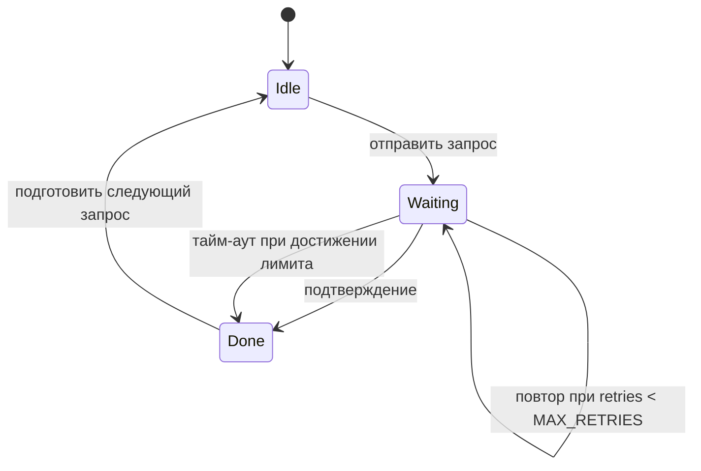

# HW5 — темпоральные свойства и проверка модели

Проверяется протокол «запрос — ответ» из практик P08/P09. Основной инструмент —
Spin, модель написана на Promela. Для неё заданы четыре свойства безопасности
и два свойства живости. Скрипт запускает Spin, собирает проверяющую программу
`pan` и воспроизводит найденные контрпримеры.

## Установка

Нужны Python 3.10+, Spin 6.5+ и GCC. Все команды выполняются из корня TVDSL-HW.
В Windows GCC должен быть доступен командой `gcc`. При установленном MinGW
можно собрать локальный Spin следующим скриптом.

```powershell
gcc --version
powershell -ExecutionPolicy Bypass -File HW5/setup.ps1
python -m HW5 check
```

`setup.ps1` скачивает исходники Spin и WinFlexBison с GitHub их авторов,
проверяет SHA256 архивов и собирает `HW5/.tools/spin.exe`.
Зафиксированы ревизия Spin `e21106ff7e58afe79275b3ca10179556afa97aa2`
и WinFlexBison 2.5.25. Для другого компилятора передайте скрипту
`-Compiler путь-к-gcc.exe`.

В Ubuntu/Debian инструменты можно установить из пакетов.

```sh
sudo apt-get install spin gcc
python3 -m HW5 check
```

Для уже установленного Spin доступен параметр `--spin` с путём к программе.
Также учитываются переменные окружения `SPIN` и `CC`.
См. [официальную установку Spin](https://spinroot.com/spin/Man/README.html)
и [исходники Spin](https://github.com/nimble-code/Spin).

## Запуск

```powershell
python -m HW5 check
python -m HW5 check --variant stalled --property response --trace
python -m HW5 check --variant overflow --property retry_bound --trace
python -m HW5 check --variant spurious --property requested --trace
python -m HW5 test
python -m unittest discover -s HW5/tests -v
python -m unittest discover -s HW5/tests -p test_course_examples.py -v
```

`check` печатает результат каждого выбранного свойства. Код завершения 0
означает, что все свойства верны, 1 — найдено нарушение, 2 — ошибка запуска
или незавершённый поиск. У ошибочных вариантов код 1 ожидаем.
`--trace` показывает значения переменных после переходов, а для бесконечного
контрпримера отмечает начало повторяющегося цикла.

`test` проверяет все шесть свойств для шести вариантов с лимитом повторов 2,
затем исправную модель с лимитами 0 и 3. Каждая строка PASS/FAIL содержит
название свойства, его смысл, ожидаемый и полученный результат.
Обнаружение предусмотренной ошибки даёт PASS.

| Параметр check | Назначение |
| --- | --- |
| `--variant` | `correct`, `spurious`, `double`, `overflow`, `stalled`, `no_reset` |
| `--property` | Проверить одно свойство из таблицы ниже. Можно повторять параметр |
| `--retries` | Лимит повторов от 0 до 5, по умолчанию 2 |
| `--trace` | Показать состояния найденного контрпримера |
| `--no-por` | Собрать проверяющую программу с `-DNOREDUCE` |
| `--depth` | Максимальная глубина поиска, по умолчанию 10000 |
| `--timeout` | Лимит каждого внешнего процесса, по умолчанию 60 секунд |
| `--out` | Каталог логов, по умолчанию `HW5/results` |
| `--spin`, `--cc` | Пути к Spin и компилятору C |

## Модель и допущения

Моделируется один клиент с одним незавершённым запросом. У запроса есть два
возможных результата — подтверждение и тайм-аут. За одну попытку сеть либо
доставляет ответ, либо требуется повтор. Число повторов ограничено
`MAX_RETRIES`. При достижении лимита разрешены подтверждение и тайм-аут.
Лимит 0 означает, что повторов нет.

| Переменная | Смысл |
| --- | --- |
| `phase` | `Idle` — запрос ещё не отправлен, `Waiting` — ждём результат, `Done` — запрос завершён |
| `issued` | Запрос отправлен. Сбрасывается при переходе из Done в Idle |
| `pending` | Запрос ожидает результата |
| `ack` | Получено подтверждение |
| `expired` | Запрос завершён по тайм-ауту |
| `retries` | Число повторных отправок текущего запроса |

Начальное состояние — Idle, все флаги ложны, `retries = 0`.



Один переход записан как `d_step`, поэтому проверяемые состояния содержат
согласованные значения флагов. Сетевые задержки выражены выбором перехода.
Отдельного времени в секундах, очереди сообщений и нескольких клиентов
в модели нет. Проверка исчерпывает конечный граф выбранной модели.

Условий fairness нет. В исправной модели повтор увеличивает счётчик, поэтому
бесконечно повторять отправку нельзя. После завершения клиент обязательно
проходит Idle и отправляет следующий запрос. В варианте `stalled` специально
разрешено бесконечно оставаться в Waiting после достижения лимита.
См. [d_step в Promela](https://spinroot.com/spin/Man/d_step.html).

## Свойства

В таблице `G` означает «всегда», `F` — «когда-нибудь».
Spin записывает их как `[]` и `<>`. Импликация `p -> q` требует `q`,
когда выполнено `p`. Для каждой формулы проверяются все выполнения модели.

| Имя | Вид | Формула LTL | Требование |
| --- | --- | --- | --- |
| `exclusive` | Безопасность | `G !(ack && expired)` | У запроса одновременно не возникают два результата |
| `requested` | Безопасность | `G ((ack \|\| expired) -> issued)` | Результат появляется после отправки запроса |
| `retry_bound` | Безопасность | `G (retries <= MAX_RETRIES)` | Лимит повторов соблюдается |
| `pending_clean` | Безопасность | `G (pending -> (issued && !ack && !expired))` | Ожидающий запрос отправлен и ещё не завершён |
| `response` | Живость | `G (pending -> F (ack \|\| expired))` | Каждый ожидающий запрос когда-нибудь завершается |
| `next_request` | Живость | `G ((phase == Done) -> F pending)` | После завершения появляется следующий ожидающий запрос |

Точные формулы находятся в конце `models/protocol.pml`.
Оператор `F` допускает текущее состояние. Для этих двух формул живости
предпосылка и требуемый результат разделены переходами модели.
См. [LTL в Spin](https://spinroot.com/spin/Man/ltl.html).

## Результаты и контрпримеры

Проверено Spin 6.5.3 и GCC 14.2.0 в Windows. Использован полный поиск
с хранением состояний, POR включён, fairness выключена. Проверяющая программа
запускается с `-a -b -m10000 -w18 -N имя_свойства`.
Опция `-b` превращает превышение глубины в ошибку, которую скрипт выдаёт
как незавершённую проверку.

Контрольный запуск с `--no-por` сохранил те же результаты. При лимите 2
проверка `response` сохраняет 14 состояний и использует 2.730 МБ памяти
по отчёту pan как с POR, так и без него. В модели один процесс,
поэтому сокращение перестановок действий разных процессов здесь не даёт
уменьшения графа. Время запуска процесса зависит от окружения и записывается
для каждого свойства в `summary.json`.

| Вариант | exclusive | requested | retry_bound | pending_clean | response | next_request |
| --- | --- | --- | --- | --- | --- | --- |
| correct | Верно | Верно | Верно | Верно | Верно | Верно |
| spurious | Верно | Нарушено | Верно | Верно | Верно | Нарушено |
| double | Нарушено | Верно | Верно | Верно | Верно | Верно |
| overflow | Верно | Верно | Нарушено | Верно | Верно | Верно |
| stalled | Верно | Верно | Верно | Верно | Нарушено | Верно |
| no_reset | Верно | Верно | Верно | Верно | Верно | Нарушено |

Для безопасности хватает конечного префикса до ошибочного состояния.
Для живости Spin предъявляет префикс и повторяемый цикл.
Сокращённые контрпримеры при `MAX_RETRIES = 2` перечислены ниже.

| Вариант и свойство | Трасса и причина |
| --- | --- |
| spurious / requested | `Idle -> Done(issued=0, ack=1)`. Подтверждение пришло без запроса |
| double / exclusive | `Idle -> Waiting -> Done(ack=1, expired=1)`. Возникли оба результата |
| overflow / retry_bound | `Idle -> Waiting(0) -> Waiting(1) -> Waiting(2) -> Waiting(3)`. Последний повтор превышает лимит |
| stalled / response | `Idle -> Waiting(0) -> Waiting(1) -> Waiting(2) -> [Waiting(2)]...`. Запрос бесконечно ожидает результата |
| no_reset / next_request | `Idle -> Waiting -> Done -> [Done]...`. Следующего запроса нет |
| spurious / next_request | После завершения повторяется цикл `[Idle -> Done(issued=0, ack=1) -> Idle]...`, в котором новых запросов нет |

У исправной модели все свойства верны также при лимитах 0 и 3.
Всего команда `test` сверяет **48 результатов** и воспроизводит шесть
контрпримеров. Дополнительно пять unittest проверяют разбор логов,
включая превышение глубины и незавершённый поиск.

Два интеграционных теста добавляют граф из `TVDSL/practices/P09_temporal_specs.md`.
Проверяются три LTL-свойства исходного графа и те же свойства после удаления
петли ожидания из упражнения 6. Исходный граф нарушает требование ответа,
а исправленный его удовлетворяет. Недостижимое состояние s3 остаётся
недостижимым в обоих случаях. Файлы Promela находятся в `tests/course/`.

Для отдельного свойства сохраняются `verify.log`, а при нарушении —
`protocol.pml.trail`, `trace.txt` и `replay.log`.
У всего запуска есть `protocol.pml` с выбранными параметрами,
`generate.log`, `compile.log` и `summary.json` с версиями, временем
проверки и количеством сохранённых состояний. Каждый запуск получает
отдельную подпапку. Логи и инструменты исключены через `.gitignore`.
См. [параметры pan](https://spinroot.com/spin/Man/Pan.html).
